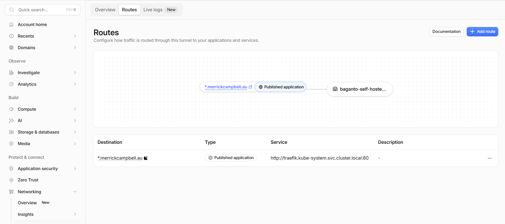
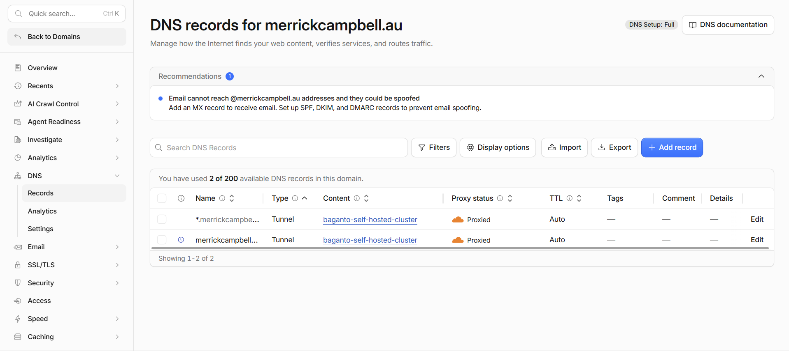

# Cloudflare Tunnel Configuration
I don't see a reason why MMS would need to continue using a CloudFlare tunnel once this has been migrated to the ARDC Nectar cloud infrastructure (since the team can generate static IP addresses in Nectar). If the team decides to continue using the tunnel, the configuration is described below.

## In-Cluster
There is a working Kubernetes manifest in the cluster as of when I am writing this. The manifest deploys the cloudflared pod, which provides the tunnel functionality. The cloudflared tunnel forwards traffic directly to the traefik service in the cluster, which handles ingress using IngressRoute rules. This traefik service will be used regardless of whether network traffic reaches the cluster directly or if it comes via the cloudflare tunnel.

## Cloudflare Setup
### 1. A Domain
In order to use Cloudflare's tunnel service, you need to have a domain that you own and can configure the DNS records for. I have used merrickcampbell.au as the domain for testing purposes. You will need to follow a guide to set up the domain. I don't know whether it is better to transfer the domain or not, but I chose just to "Connect a domain". This involved changing the name servers at my domain registrar to be the cloudflare name servers assigned to my account. Once the domain is connected, you can open up the DNS page and delete all DNS entries (unless there is something else using the domain that you actually care about). 

### 2. A Tunnel
Once you have deleted all domain entries, create a Tunnel (again, follow a guide) for a publicly accessible application. You will be given a tunnel secret, which you will need to seal and put into the kubernetes cluster so that your pod can create the tunnel. There should already be a template for a sealed secret which you can use as a guide. Your tunnel routes configuration should be as follows: 
Creating this tunnel should update your DNS entries to be as follows: 