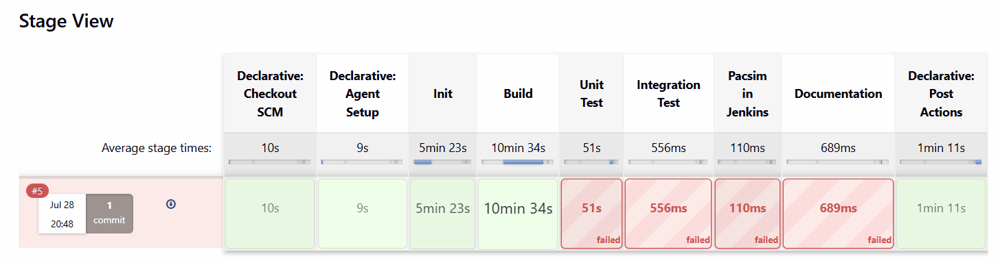
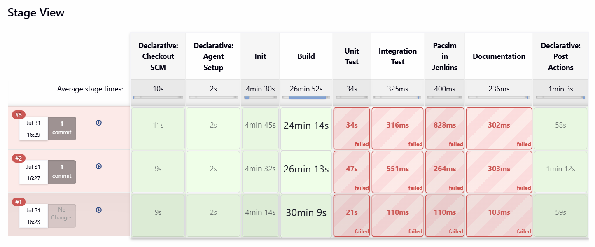

# Goals For MMS

MMS has access to the ARDC Nectar compute cloud, an OpenStack-based allocation
for Australian research and education teams, with enough headroom to run
bursts of heavier Kubernetes workloads alongside its steady-state services.
Nectar also supports pre-emptible (spot) instances for workloads that can
tolerate interruption, at a reduced cost compared to on-demand capacity (see
https://support.ehelp.edu.au/support/solutions/articles/6000243910-nectar-preemptible-instance-service).
This is a solid starting point for running heavy workloads. Exact allocation
sizing isn't detailed here since it's tied to MMS's specific grant and changes
over time — see Nectar's own documentation for current tiers and limits.

The ARDC Nectar cluster is an OpenStack deployment and supports the OpenStack
SDK and tooling. Deploying a Kubernetes cluster on Nectar (see
https://tutorials.rc.nectar.org.au/kubernetes/01-overview) lets the team run
containerised services and jobs with efficient scaling, and supports a GitOps
approach to server management — improving reproducibility and ensuring the
cluster doesn't become unmaintainable after the current team moves on.

## Changes To Jenkins

The team currently hosts its Jenkins server on ARDC on a dedicated 16 vCPU,
32GB RAM VM. This setup works, but wastes Service Units: Jenkins only
processes a handful of pull requests per day and sits idle the rest of the
time, especially overnight.

The proposed change is to use the Jenkins Kubernetes plugin to run Jenkins
agents on Kubernetes instead of on a static VM. In this model, Jenkins runs a
lightweight controller that schedules jobs onto on-demand agent pods — the
controller itself doesn't execute any jobs, so it can run with a small
resource footprint (roughly 2 vCPU / 4GB RAM). The cluster then autoscales:
new nodes are provisioned when the Kubernetes API reports pods to schedule,
and scaled back down once the agents are no longer needed. This introduces a
scale-up delay (roughly 1-2 minutes) before a job starts, which is small
relative to typical pipeline length, and in exchange enables many pipelines to
run in parallel without resource contention.

The build stage of the MMS pipeline should produce a deployable Docker image
that can be fed into BagAnTo for testing. BagAnTo should handle its own
orchestration independently rather than being supervised by the Jenkins
controller node — Jenkins' role is to build the image, publish it to the
container registry, and then trigger a BagAnTo run (either in parallel with
the rest of the pipeline, or at the end of it).

## Observations From The Existing Jenkins Setup

A few inefficiencies observed while reviewing the current Jenkins pipeline,
worth addressing independently of the Kubernetes migration above:

1. **Superseded commits still run to completion.** A pull request with
   several commits pushed within a few minutes of each other currently
   triggers a separate full pipeline run for each commit, run in parallel on
   separate executors — multiplying total build time with no benefit, since
   the result of a superseded commit is rarely needed. Automatically
   cancelling a pipeline run when a newer commit lands on the same branch
   would free up executor capacity for commits that matter, at the cost of
   occasionally cancelling a run that was about to finish, or complicating
   "which commit is safe to revert to" bookkeeping if a cancelled run is later
   needed. In practice, commits that close together are unlikely to need their
   individual pipeline output preserved.

   One non-parallel Jenkins run:
   

   Three commits pushed minutes apart, triggering three parallel runs (total
   build time is nearly 3x a single run):
   

2. **Agent setup runs on every pipeline execution.** The "Declarative: Agent
   Setup" stage currently re-runs for every pipeline invocation, even though
   agent setup should be largely independent of the specific commit under
   test. A scheduled (daily/weekly) job that rebuilds and publishes the agent
   image, with pipelines simply referencing that image by tag, would remove
   this overhead from the common path. There are likely other opportunities to
   cache and reuse build artifacts across pipeline runs more effectively.
